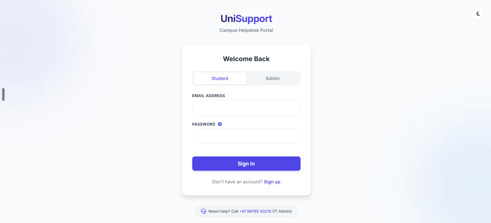
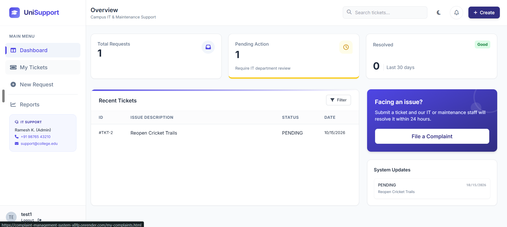
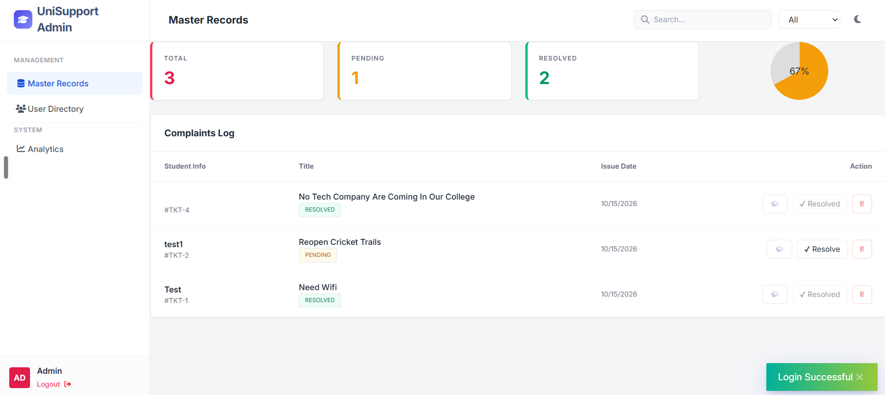

# UniSupport – Campus Complaint Management System

A web portal where students raise complaints/support tickets (IT, hostel, library, maintenance, etc.) and administrators review, respond to and resolve them. Built with Spring Boot and deployed on free-tier cloud services.

**Live demo:** https://complaint-management-system-x8fp.onrender.com/
> Hosted on a free plan, so the first load after a period of inactivity can take 30–60 seconds.





## Features

**Students**
- Sign up / log in with a validated, strong password
- Raise a complaint with category and priority (low / medium / high / critical)
- Track "My Complaints", open ticket details, edit own tickets, mark own complaint resolved
- See the admin's comments and status updates

**Admins**
- Dashboard with complaint and user statistics
- View all complaints, change status (Pending / In Progress / Resolved), add comments, delete
- View registered users

## Security

- Spring Security session login, passwords hashed with **BCrypt**
- **CSRF protection** (cookie token + `X-XSRF-TOKEN` header)
- Role-based access control (USER / ADMIN) enforced on the server for every API route
- **Ownership checks**: a student can only read or change their own complaints (no IDOR); the owner is taken from the logged-in session, never from the request
- **Input validation** (Bean Validation) on all request DTOs; entities and password hashes are never returned by the API
- **Login rate limiting** per email and per IP (HTTP 429 with `Retry-After`)
- HttpOnly + SameSite session cookie, `Secure` flag in production, security headers (frame deny, nosniff, referrer policy)
- HTML output escaped on the frontend to prevent XSS
- All secrets (DB credentials, admin password) come from environment variables, never from the repository

## Tech stack

| Layer | Technology |
|---|---|
| Backend | Java 17, Spring Boot 3.5, Spring Security 6, Spring Data JPA / Hibernate |
| Database | MySQL (production), H2 in-memory (development and tests) |
| Frontend | HTML, JavaScript, Tailwind CSS (built locally, no CDN) |
| Build / Test | Maven, JUnit 5, MockMvc integration tests |
| Deploy | Docker (multi-stage build), Render (web service), Aiven (managed MySQL), UptimeRobot (uptime monitor) |

## Project structure

```
src/main/java/com/cms/cms/
  config/       security, admin seeding, rate limiter, exception handling
  controller/   Auth, Complaint, Admin, Health REST controllers
  dto/          request/response objects with validation
  model/        JPA entities (User, Complaint)
  repository/   Spring Data repositories
  service/      business rules and ownership checks
src/main/resources/
  static/       HTML pages + common.js
  application*.properties   dev / prod / test profiles
src/test/       integration tests for security and complaint flows
```

## Run locally

Requirements: JDK 17+ (works on newer JDKs). No database install needed in dev mode.

```bash
./mvnw spring-boot:run        # Windows: mvnw.cmd spring-boot:run
```

Open http://localhost:8080. The `dev` profile uses an in-memory H2 database and creates a dev admin account (see `application-dev.properties`). This account exists only in dev.

Run the tests:

```bash
./mvnw test
```

## Deploy

The `prod` profile reads configuration from environment variables:

| Variable | Purpose |
|---|---|
| `SPRING_PROFILES_ACTIVE` | `prod` |
| `DB_URL` | `jdbc:mysql://HOST:PORT/DBNAME?sslMode=REQUIRED&characterEncoding=UTF-8` |
| `DB_USER`, `DB_PASS` | database credentials |
| `APP_ADMIN_EMAIL`, `APP_ADMIN_PASSWORD` | admin account created on first start (use a strong password) |
| `COOKIE_SECURE` | `true` when served over HTTPS |

Step-by-step guides: [DEPLOY_FREE.md](DEPLOY_FREE.md) (Render + Aiven free tier) and [DEPLOY.md](DEPLOY.md) (Docker / own server). A `/api/health` endpoint is provided for uptime monitoring.

## Roadmap

- Email-based password reset and email notifications
- College-email-only signup and department-wise admin roles
- Status history log and file attachments
- Pagination and search, database migrations (Flyway), automated backups

## Author

Built by Amit ([@amit731053](https://github.com/amit731053)).
